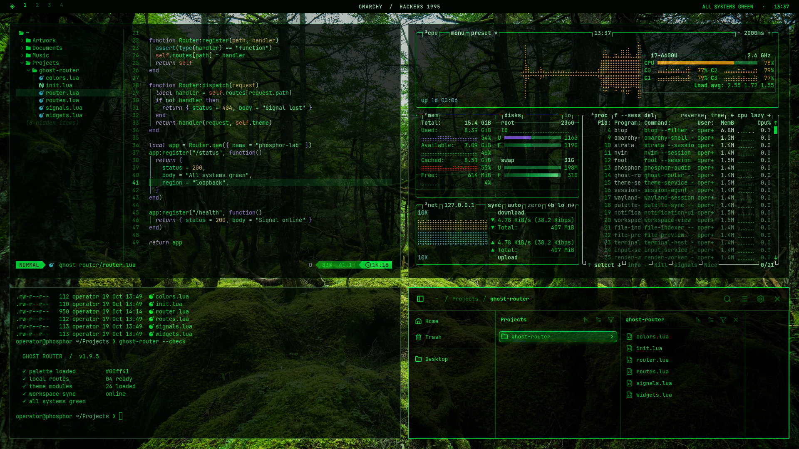

# Hackers 1995

Green phosphor text, near-black surfaces, and restrained mint, amber, cyan, and violet accents for Omarchy 4.



## Install

Install with **Omarchy Menu → Install → Style → Theme** and paste the repository URL:

```text
https://github.com/Waffles46/omarchy-hackers-1995-theme
```

Select **Hackers 1995** in the theme menu with **Super + Ctrl + Shift + Space**.

The marketplace submission is being prepared.

## What the theme includes

- A complete dark palette in `colors.toml`.
- Omarchy shell surfaces, menus, notifications, and lock-screen colors.
- A green btop theme with readable monitoring accents.
- A near-black Chromium theme color.
- A mossy Japanese forest wallpaper by TAKAO_Tsushima, redistributable under CC BY 4.0.

Omarchy generates its supported terminal and editor configurations from the palette. This repository deliberately supplies no executable Lua, terminal configuration, or installer scripts. It does not change window layouts, keybindings, fonts, or application data.

## Palette

| Role | Color |
| --- | --- |
| Background | `#010603` |
| Foreground / accent | `#00ff41` |
| Muted text | `#145c2d` |
| Mint | `#65ff9d` |
| Cyan | `#36c5d9` |
| Violet | `#b58cff` |
| Amber | `#d9b44a` |

The ANSI red slot intentionally uses green for the phosphor terminal style. Applications that communicate errors only through ANSI red will display those errors in green; applications can still use their own semantic error color.

## Optional app profiles

The author's personal setup also includes transparent windows, a Strata profile, Signal customization, and a custom Spotify terminal. Those are separate from a standard Omarchy theme installation. See [optional app profiles](docs/app-profiles.md) for the exact boundary and the portable Strata palette.

The preview includes the native Neovim, btop, Foot, and Strata interfaces, with a sample project under the operator account. The Strata palette and window transparency are optional personal configuration; installing this theme alone does not install Strata or reproduce the author's entire desktop layout.

## Wallpaper and credits

The default wallpaper is **Forest of moss, pond of Shirakoma**, © TAKAO_Tsushima, available under [CC BY 4.0](https://creativecommons.org/licenses/by/4.0/). The original 4500 × 3002 photograph is included unchanged as `backgrounds/0-shirakoma-forest.jpg`.

[Source and license record on Wikimedia Commons](https://commons.wikimedia.org/wiki/File:Forest_of_moss,_pond_of_Shirakoma.jpg) · [Original on FIND/47](https://search.find47.jp/en/i/CunqI).

The original photograph is included unchanged. You may redistribute or adapt it under CC BY 4.0; retain the photographer's credit, source, and license link, and identify any changes. The photographer does not endorse this theme.

The desktop preview is by Waffles46 and is also available under CC BY 4.0. It incorporates the photograph above, fitted to the screen and overlaid with application windows. Suggested credit: **Hackers 1995 desktop preview by Waffles46; background photograph © TAKAO_Tsushima / FIND/47; CC BY 4.0**. Include the photograph's source and the license link above when republishing it. Third-party applications shown retain their respective licenses.

Further details are in [CREDITS.md](CREDITS.md) in the source repository.

The author's existing local forest photograph remains personal and is not included in this release.

Shell configuration structure derives from [Omarchy](https://github.com/omacom/omarchy), copyright David Heinemeier Hansson, under the MIT license. This theme is a community project and has no affiliation with the film *Hackers* or its rights holders.

## Compatibility

Prepared against Omarchy **4.0.5-1**. See [validation notes](docs/validation.md) for the checks performed and remaining publication steps.

## License

Theme configuration and documentation: [MIT](LICENSE). Wallpaper and preview: [CC BY 4.0](https://creativecommons.org/licenses/by/4.0/), with attribution above.
